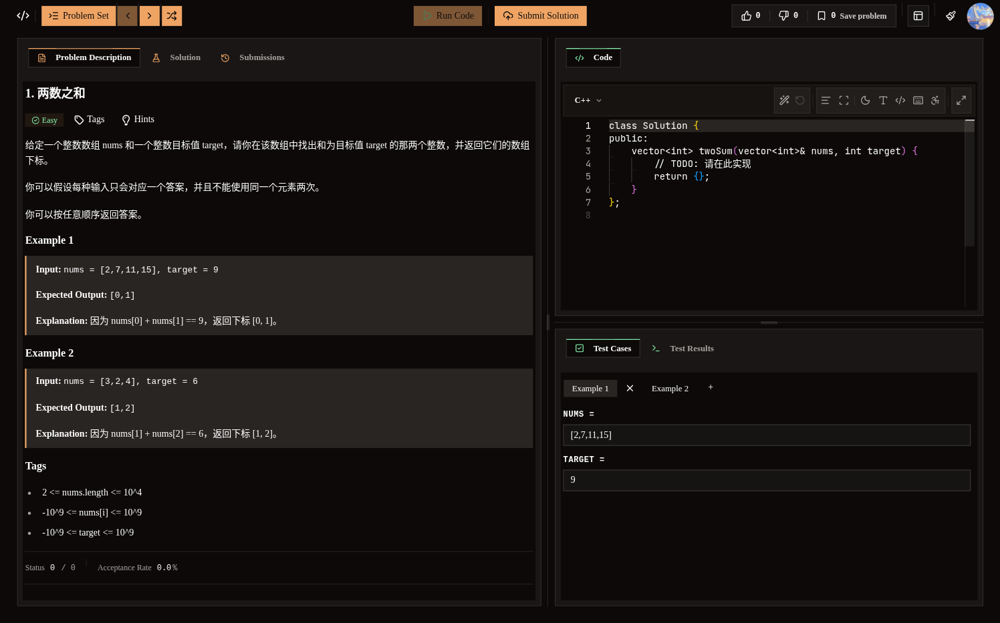
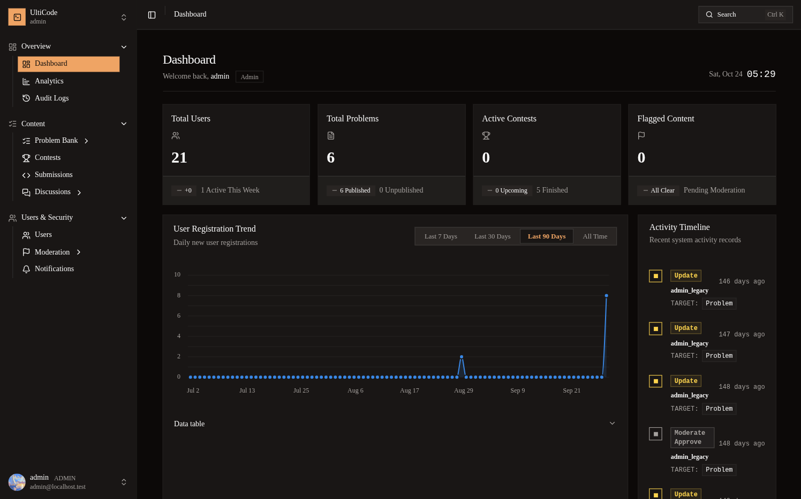

<div align="center">

# UltiCode

**开源在线编程平台 · 从题目练习到竞赛评测**

**Java 17 · Spring Boot · Vue 3 · TypeScript · Docker**

[English](README.md) · **简体中文**

[快速开始](#快速开始) · [界面预览](#界面预览) · [项目文档](docs/index.md) · [参与贡献](#参与贡献)

[MIT License](LICENSE) · [报告问题](https://github.com/DavidHLP/UltiCode/issues) · [CI 工作流](https://github.com/DavidHLP/UltiCode/actions/workflows/ci.yml)

</div>

---

## 项目介绍

UltiCode 是一个全栈在线编程平台，提供题库、竞赛、在线评测、题解、社区和管理后台。

## 核心能力

| 场景 | 能力 |
| --- | --- |
| 编程练习 | 题库、竞赛、代码提交与评测记录 |
| 学习与交流 | 题解、论坛、成就和个人中心 |
| 平台管理 | 题目与竞赛管理、审核、审计、通知和运营查询 |
| 代码评测 | 独立 Judge Worker 消费 Submission 的 Redis Streams，使用 Docker 沙箱执行代码 |

## 界面预览

以下为仓库维护的设计与回归参考截图，更多页面见[截图索引](assets/screenshots/README.md)。

| 用户端 · 题目详情 | 管理端 · 仪表板 |
| :---: | :---: |
|  |  |

## 技术栈摘要

| 层次 | 技术 |
| --- | --- |
| 后端 | Java 17、Spring Boot、Maven、MyBatis-Plus、Flyway、Dubbo |
| 前端 | Vue 3、TypeScript、Vite、pnpm workspace |
| 基础设施 | Docker Compose、MySQL、Redis、Nacos、MeiliSearch |

## 快速开始

### 1. 获取项目

```bash
git clone --branch v1.0.4 https://github.com/DavidHLP/UltiCode.git
cd UltiCode
```

### 2. 在生成配置前选择安装路径

当前发行版是 [v1.0.4（2026-10-27）](https://github.com/DavidHLP/UltiCode/releases/tag/v1.0.4)。
普通使用者应固定发行版，不直接跟随 `main`；贡献者可在独立 checkout 使用 `main`。

- **下载发行版镜像部署**：从[发行版安装](docs/OPERATIONS.md#从已发布发行版安装)开始，下载全部资产、验证校验和与九镜像签名证据，再准备主机 TLS/Judge 和部署审批。
- **全新本机开发环境**：在 `.env` 尚不存在时进入[干净卷首次安装](docs/DEVELOPMENT.md#干净卷首次安装仅本机-disposable-开发环境)。该入口负责生成配置、迁移、backfill/parity、cutover 与首次启动；不要提前运行 `init-env.sh`。
- **已有配置、数据库或卷**：保留它们，先阅读[升级与回滚](docs/OPERATIONS.md#升级与回滚入口)。不得把已有环境当成空卷，也不要使用 `--force` 重建配置或只修改 cutover marker。

本机源码开发需要 Docker Compose v2、mise 管理的 Zulu Java 17、Node.js 22.x（至少 22.22.2）、pnpm 11.0.0、PM2、`curl`、`timeout` 和 `openssl`。Dev Container 只准备工具链和 unit 验证，不自动启动业务栈。精确前置条件、scope、readiness 与排障见[本地开发](docs/DEVELOPMENT.md#本地开发)。

完成所选入口后，开发前端为 [Console](http://localhost:9002) 与 [Management](http://localhost:9003)。不要通过直接启动 Maven/PM2 绕过 launcher 的准备和安全门禁。

<details>
<summary>可选 Core 试点与回滚说明</summary>

Core 收敛试点使用显式 scope，保持 Judge 独立进程：

```bash
./scripts/dev/up.sh --scope core
./scripts/dev/test.sh core
```

Core parent 监听 `9108`，readiness 为 `/api/v1/core/health/ready`；该 profile
当前用于 owner assembly 和边界验证，尚未替代默认 distributed topology。

当前版本不再支持 `legacy-rollback`；`up.sh` 对该旧模式和未知 mode fail closed。生产回滚只能使用部署方保留并校验的上一份完整 release descriptor，不能通过当前二进制恢复旧实现（见[部署、发布与回滚](docs/OPERATIONS.md#部署发布与回滚)）。

</details>

## 项目结构

```text
UltiCode/
├── apps/
│   ├── console/       # 用户端
│   └── management/    # 管理端
├── packages/          # 前端共享包
├── services/          # 后端服务、API 契约与 Worker
├── init-db/           # 数据库初始化与 Flyway migrations
├── docker/            # 基础设施与评测沙箱
├── scripts/           # 开发、验证与运维入口
└── docs/              # 架构、开发与部署文档
```

默认采用 **distributed** 拓扑。Auth、Admin、App、Submission、Notification 分别负责自己的数据和写入边界；Judge 负责评测，Search 维护派生索引。详见[架构总览](docs/ARCHITECTURE.md)。

## 文档入口

- [文档导航](docs/index.md)：产品、架构、开发、运维和 API/认证的六个核心来源。
- [产品与领域](docs/PRODUCT.md)：产品定位、角色、能力与边界。
- [架构与系统边界](docs/ARCHITECTURE.md)：服务边界、Owner/Worker 拓扑、数据流、契约和安全边界。
- [开发与测试](docs/DEVELOPMENT.md)：本地启动、验证、配置、规则与排障。
- [运维](docs/OPERATIONS.md)：部署、发布、回滚、迁移、备份、监控和事件响应。
- [API 与认证参考](docs/REFERENCE.md)：浏览器流程、API 入口和内部契约。

实现、配置、迁移脚本、测试和可执行 runbook 是行为真相；本仓库没有生产环境，生产部署、真实流量和外部凭据由部署方负责。

## 参与贡献

欢迎通过 [Issues](https://github.com/DavidHLP/UltiCode/issues) 报告问题、讨论改进，或提交 Pull Request。

1. 报告问题时，附上复现步骤、预期与实际行为，以及脱敏后的环境信息。
2. 开始前阅读 [`AGENTS.md`](AGENTS.md) 与相关目录指南；较大改动先通过 Issue 讨论范围。
3. 为行为变更补充相应测试，按[开发指南](docs/DEVELOPMENT.md)运行对应检查。
4. 在 Pull Request 中说明改动原因、验证方式与已知限制。

提交前检查 `git diff --check`，并运行与触碰面对应的 `./scripts/dev/test.sh` gate。不得提交 `.env`、凭据、私钥或生成的运行时材料。

## 许可证

本项目基于 [MIT License](LICENSE) 开源。
